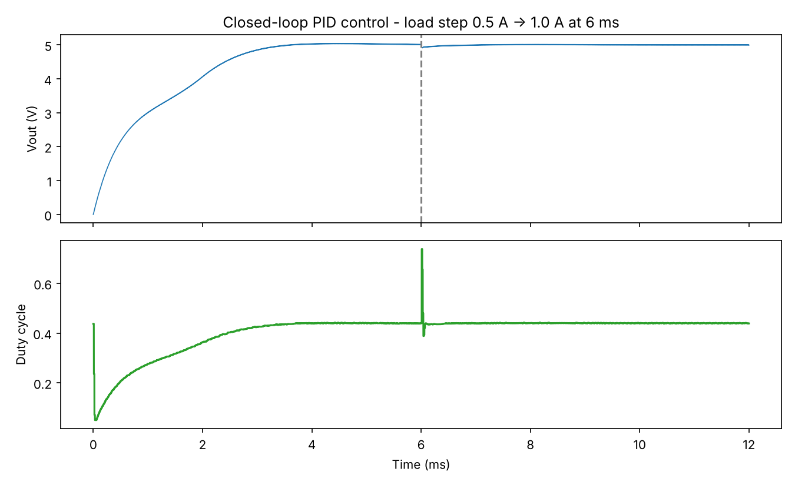
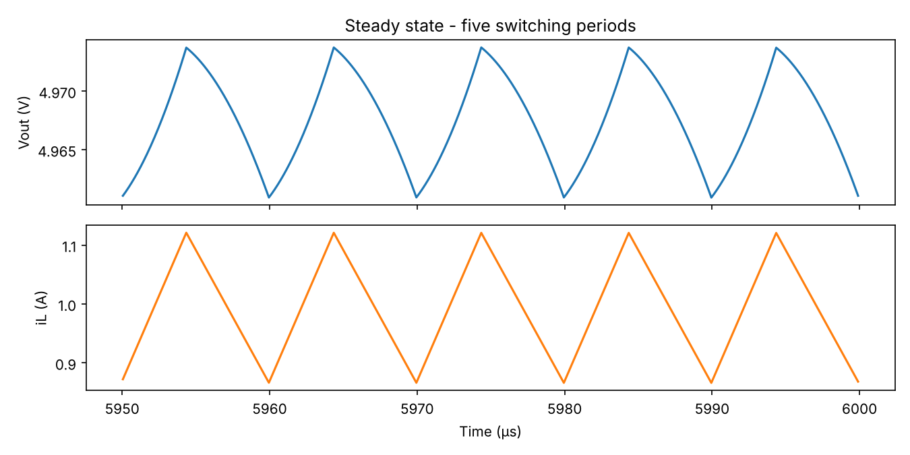

# ⚡ DC-DC Buck Converter: Design, Simulation & Control

**A 12 V → 5 V, 1 A buck converter, taken from the design equations through a switching-level simulation to closed-loop control, all in Python.**



## Specification
| Parameter | Value |
|---|---|
| Input | 12 V |
| Output | 5 V, 1 A (5 W) |
| Switching frequency | 100 kHz |
| Inductor ripple target | 30% of load current |
| Output ripple target | ≤ 50 mV peak-to-peak (1%) |
| Switch / diode | N-MOSFET (Rds(on) ≈ 50 mΩ) + Schottky (Vf ≈ 0.45 V) |

## 1. Design ([`src/design.py`](src/design.py) → [`reports/design.md`](reports/design.md))
| Quantity | Calculated | Chosen part |
|---|---|---|
| Duty cycle (incl. diode drop) | 0.438 | — |
| Minimum inductance | 102 µH | **120 µH**, ≥ 1.5 A rated |
| Minimum output capacitance | 7.5 µF | **100 µF** electrolytic + 0.1 µF ceramic |
| Inductor peak current | 1.15 A | — |
| Continuous-conduction limit | stays continuous down to 0.15 A load | — |
| Estimated efficiency | **93.0%** | Diode conduction is the largest loss (0.25 W of 0.38 W) |

## 2. Switching-level simulation ([`src/simulate.py`](src/simulate.py))
The converter is simulated at 200 time-steps per switching period, with conduction losses, the diode drop and discontinuous-mode behaviour included. No SPICE licence is needed.

**Open loop at the designed duty cycle**
| Check | Design equation | Simulation |
|---|---|---|
| Inductor ripple (with 120 µH) | 0.255 A | **0.260 A** ✅ |
| Output ripple | ≤ 50 mV | **18.9 mV** ✅ |
| Output voltage | 5.0 V | 4.97 V (−0.7%, losses not corrected in open loop) |



**Closed loop: PID voltage control with soft-start**
- A plain PI controller made the output **ring**: the 120 µH / 100 µF filter resonates near 1.5 kHz. Adding a **derivative term** damped it. The gains were chosen by a parameter sweep.
- A 2 ms **soft-start** cut start-up overshoot from about 16% to **0.9%**.

| Metric | Result |
|---|---|
| Regulation after load step | **5.000 V** |
| Undershoot on 0.5 A → 1.0 A step | 112 mV |
| Recovery to within 1% | **0.23 ms** |
| Output ripple at full load | 13.4 mV p-p |

## 3. Hardware
The hardware prototype covers the gate drive, the power stage built around the parts sized above, and bench measurements of output ripple and efficiency. Photos, schematic and measured results go in [`hardware/`](hardware).

## Run it
```bash
pip install -r requirements.txt
python src/design.py       # sizing + loss budget -> reports/design.md
cd src && python simulate.py   # simulation + figures -> reports/
```
Every number in this README comes from these two scripts. Change the `Spec` values in `design.py` to redesign the converter for any input, output or load.

## What I'd do next
- Peak-current-mode control (removes the resonance problem altogether)
- Swap the Schottky for a synchronous MOSFET, which removes the biggest loss (~0.25 W → under 0.05 W)
- Bode plot / loop-gain analysis to confirm phase margin formally

## Tech
Python · NumPy · Matplotlib · power electronics · control systems

---
Built by **Madhvi Singh** · B.Tech Electrical Engineering, NIT Kurukshetra · [LinkedIn](https://linkedin.com/in/madhvi-singh265)
